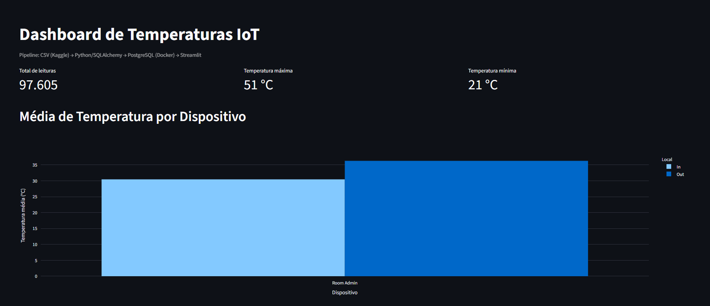
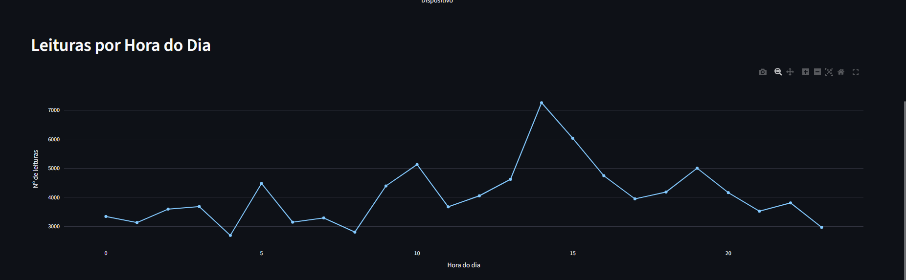
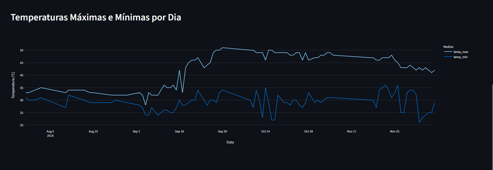

# Pipeline de Dados com IoT e Docker

Projeto da disciplina **Disruptive Architectures: IoT, Big Data e IA** (UniFECAF – Análise e Desenvolvimento de Sistemas).

Pipeline que lê leituras de temperatura de dispositivos IoT (CSV do Kaggle), trata os dados com Python, armazena em um **PostgreSQL rodando no Docker**, cria **3 views SQL** e exibe os resultados em um **dashboard Streamlit** com gráficos interativos.

```
CSV (Kaggle) ──► Python (pandas + SQLAlchemy) ──► PostgreSQL (Docker) ──► Views SQL ──► Streamlit (Plotly)
```

## Tecnologias

| Tecnologia | Uso |
|---|---|
| Python 3 + pandas | Leitura, limpeza e conversão de tipos do CSV |
| SQLAlchemy + psycopg2 | Conexão e carga no PostgreSQL |
| PostgreSQL 16 (Docker) | Armazenamento e views SQL |
| Docker / Docker Compose | Banco reproduzível em qualquer máquina |
| Streamlit + Plotly | Dashboard com gráficos interativos |
| Git / GitHub | Versionamento e entrega |

## Estrutura do repositório

```
.
├── data/                 # CSV do Kaggle (IOT-temp.csv)
├── docs/screenshots/     # Capturas de tela do dashboard
├── sql/
│   ├── views.sql         # As 3 views SQL
│   └── insights.sql      # Consultas auxiliares para os insights
├── src/
│   ├── db.py             # Conexão com o PostgreSQL
│   ├── ingest.py         # Carga: CSV -> PostgreSQL (+ cria as views)
│   └── dashboard.py      # Dashboard Streamlit
├── docker-compose.yml    # PostgreSQL via Docker
├── requirements.txt
└── .env.example
```

## Base de dados

Dataset **Temperature Readings: IoT Devices** (Kaggle):
https://www.kaggle.com/datasets/atulanandjha/temperature-readings-iot-devices

Baixe o CSV e salve como `data/IOT-temp.csv`. Colunas originais: `id`, `room_id/id`, `noted_date`, `temp`, `out/in`.

## Como executar

Pré-requisitos: Python 3.10+, Docker e Git.

```bash
# 1. Clonar o repositório
git clone https://github.com/Luc14saro/Lucas-Araujo-Saro-bigdatafecaf.git
cd Lucas-Araujo-Saro-bigdatafecaf

# 2. Ambiente virtual e dependências
python -m venv .venv
source .venv/bin/activate        # Windows: .venv\Scripts\activate
pip install -r requirements.txt

# 3. Subir o PostgreSQL no Docker
docker compose up -d
docker compose ps                # aguarde o status "healthy"

# 4. Colocar o CSV em data/IOT-temp.csv (ver seção "Base de dados")

# 5. Carregar os dados e criar as views
python src/ingest.py

# 6. Abrir o dashboard (http://localhost:8501)
streamlit run src/dashboard.py
```

Credenciais padrão (definidas no `docker-compose.yml`): usuário `iot_user`, senha `iot_pass`, banco `iot_db`, porta `5432`. Para trocar, copie `.env.example` para `.env` e exporte as variáveis.

Alternativa com `docker run` direto (como no enunciado):

```bash
docker run --name postgres-iot -e POSTGRES_USER=iot_user -e POSTGRES_PASSWORD=iot_pass \
  -e POSTGRES_DB=iot_db -p 5432:5432 -d postgres:16
```

Verificar os dados no banco:

```bash
docker exec -it postgres-iot psql -U iot_user -d iot_db -c "SELECT COUNT(*) FROM temperature_readings;"
```

## Views SQL

Definidas em [`sql/views.sql`](sql/views.sql) e criadas automaticamente pelo `ingest.py`.

1. **`avg_temp_por_dispositivo`**: temperatura média e total de leituras por dispositivo e por local (interno/externo). Serve para comparar sensores e medir a diferença entre dentro e fora.
2. **`leituras_por_hora`**: quantidade de leituras por hora do dia (0–23). Mostra quando os dispositivos mais enviam dados e ajuda a achar lacunas de coleta.
3. **`temp_max_min_por_dia`**: temperatura máxima e mínima de cada dia. Mostra a amplitude térmica diária e destaca dias com picos ou quedas anormais.

## Dashboard

Capturas de tela geradas com o CSV real (salvas em `docs/screenshots/`):





## Insights

Resultados obtidos com `sql/insights.sql` sobre os 97.605 registros carregados (28/07/2018 a 08/12/2018):

- **Visão geral:** temperatura média de 35,05 °C, com mínima de 21 °C e máxima de 51 °C.
- **Interno x externo:** a média externa (36,27 °C) é 5,82 °C maior que a interna (30,45 °C). Cerca de 79% das leituras são externas.
- **Horários de coleta:** pico às 14h (7.248 leituras), seguido de 15h (6.029) e 10h (5.127). Menos leituras às 4h (2.690), 8h (2.803) e 23h (2.967).
- **Amplitude diária:** maior variação em 16/10/2018, de 22 °C a 50 °C (28 °C). Os quatro dias de maior amplitude são de outubro (10, 13, 16 e 17).
- **Evolução no período:** as máximas diárias passam de cerca de 33 a 35 °C em agosto para 45 a 51 °C a partir do fim de setembro. Os dados não permitem afirmar a causa.

Usos práticos: alertas de temperatura fora da faixa, monitoramento de ambientes (salas de servidores, câmaras frias, estufas), manutenção preditiva e controle de climatização.

## Comandos Git utilizados

```bash
git config --global user.name "Seu Nome"
git config --global user.email "seu.email@exemplo.com"

git init
git add .
git commit -m "Projeto inicial: Pipeline de Dados IoT"
git remote add origin https://github.com/Luc14saro/Lucas-Araujo-Saro-bigdatafecaf.git
git push -u origin main

git pull        # atualizar o repositório local com o remoto
```

## Autor

Lucas Araujo Saro: UniFECAF, Análise e Desenvolvimento de Sistemas (RA 127714)
